# 05.2 Diagrama Entidad-Relación (DER) y Modelo Relacional

## 1. Diagrama Entidad-Relación Completo (Mermaid)

```mermaid
erDiagram
    User ||--o{ Project : "posee"
    User ||--o{ UserApiKey : "guarda"
    User ||--o| UserAiRoleConfig : "configura"

    Project ||--o{ ParentPromptVersion : "versiona"
    Project ||--o{ Contract : "define"
    Project ||--o{ AuditRun : "registra"

    ParentPromptVersion ||--o{ AuditRun : "contextualiza"
    AuditRun ||--o{ AuditFinding : "contiene"

    User {
        string id PK
        string githubId UK
        string username
        string email
        string avatarUrl
        int sessionVersion
        int keyVersion
        string githubTokenEncrypted
        string githubTokenIv
        string githubTokenTag
        datetime createdAt
        datetime updatedAt
    }

    Project {
        string id PK
        string userId FK
        string githubRepoId
        string name
        string repoOwner
        string repoName
        string defaultBranch
        string contractsPath
        string frontendPath
        string backendPath
        enum agentsMdSyncStatus
        string agentsMdSha
        datetime agentsMdSyncedAt
        string agentsMdLastSyncError
        datetime createdAt
        datetime updatedAt
    }

    ParentPromptVersion {
        string id PK
        string projectId FK
        int versionNumber
        string summary
        text content
        enum status
        enum syncStatus
        string githubFileSha
        datetime syncedToGithubAt
        string lastSyncError
        datetime createdAt
    }

    Contract {
        string id PK
        string projectId FK
        string moduleName
        int versionNumber
        enum status
        enum httpMethod
        string endpointPath
        jsonb schemaJson
        text tsContent
        string filePath
        boolean generatedByAi
        datetime approvedAt
        enum syncStatus
        string githubFileSha
        datetime syncedToGithubAt
        string lastSyncError
        datetime createdAt
        datetime updatedAt
    }

    UserApiKey {
        string id PK
        string userId FK
        enum provider
        int keyVersion
        string encryptedKey
        string iv
        string authTag
        string keyHint
        boolean isValid
        datetime lastTestedAt
        datetime createdAt
        datetime updatedAt
    }

    UserAiRoleConfig {
        string id PK
        string userId FK
        enum contractProvider
        string contractModel
        enum frontendAuditorProvider
        string frontendAuditorModel
        enum backendAuditorProvider
        string backendAuditorModel
        datetime updatedAt
    }

    AuditRun {
        string id PK
        string projectId FK
        string parentPromptVersionId FK
        enum refType
        string refName
        string baseBranch
        int prNumber
        string headCommitSha
        string baseCommitSha
        enum layerAudited
        enum trafficLight
        int filesAnalyzedCount
        int excludedFilesCount
        string[] analyzedFilePaths
        jsonb contractVersionsUsed
        jsonb modelsUsed
        boolean boundaryViolation
        text summary
        text consolidatedFixPrompt
        datetime createdAt
    }

    AuditFinding {
        string id PK
        string auditRunId FK
        enum layer
        enum severity
        string filePath
        string lineRef
        string title
        text explanation
        text recommendation
        text fixPrompt
        datetime createdAt
    }
```

---

## 2. Matriz de Relaciones y Comportamiento al Borrar (Integridad Referencial)

| Relación | Cardinalidad | Etapa | Regla al eliminar el padre | Explicación práctica |
| :--- | :--- | :--- | :--- | :--- |
| `User` → `Project` | 1 a muchos (1:N) | 1A | `CASCADE` | Un usuario puede conectar varios repositorios. Si en una versión futura se implementa eliminación de cuenta, se borran sus registros locales (nunca borra repositorios en GitHub). |
| `User` → `UserApiKey` | 1 a muchos (1:N) | 1B | `CASCADE` | Hasta 1 clave por proveedor (Gemini, OpenAI, DeepSeek). Además, al eliminar una clave individual, una transacción limpia referencias en `UserAiRoleConfig`. |
| `User` → `UserAiRoleConfig` | 1 a 0..1 (1:1) | 1B | `CASCADE` | Ficha única de asignación de modelos por rol. |
| `Project` → `ParentPromptVersion` | 1 a muchos (1:N) | 1A | `CASCADE` | Historial versionado (`v1`, `v2`, `v3`...) del Prompt Padre del proyecto. |
| `Project` → `Contract` | 1 a muchos (1:N) | 1A | `CASCADE` | Múltiples módulos de contrato y sus versiones históricas. |
| `Project` → `AuditRun` | 1 a muchos (1:N) | 1B | `CASCADE` | Historial completo de auditorías manuales del proyecto. |
| `ParentPromptVersion` → `AuditRun` | 1 a muchos (1:N) | 1B | `SET NULL` | Cada auditoría registra con qué versión del Prompt Padre se evaluó; si esa referencia desaparece, el reporte se conserva. |
| `AuditRun` → `AuditFinding` | 1 a muchos (1:N) | 1B | `CASCADE` | Una auditoría tiene 0 hallazgos (`GREEN`) o múltiples hallazgos (`YELLOW`/`RED`). |

---

## 3. Glosario Rápido de Siglas del Diagrama
* **PK (Primary Key / Llave Primaria):** Identificador único irrepetible de cada fila.
* **FK (Foreign Key / Llave Foránea):** Enlace al `id` de otra tabla.
* **UK (Unique Key / Llave Única):** Restricción que impide valores repetidos.
* **CASCADE:** Al eliminar el padre, la base de datos elimina automáticamente sus hijos.
* **SET NULL:** Al eliminar el padre, el hijo permanece y solo vacía la columna de enlace.
