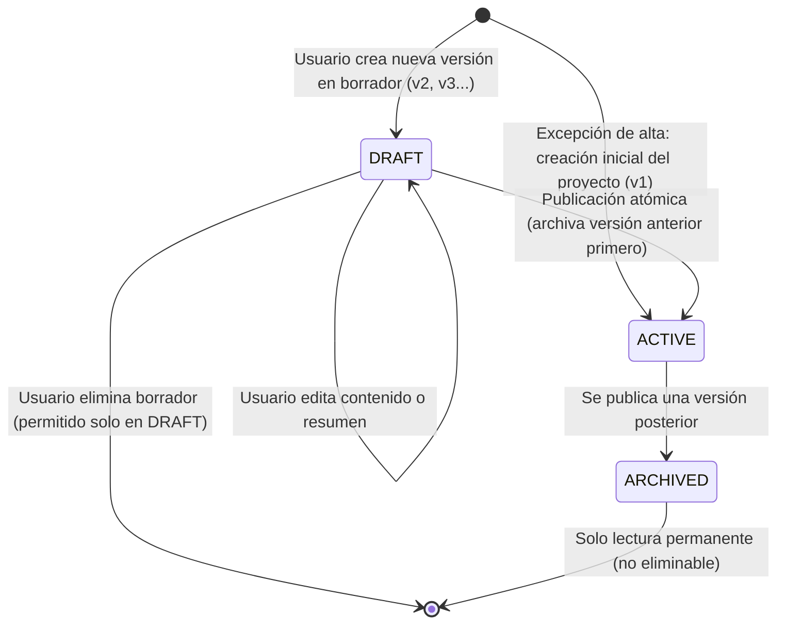
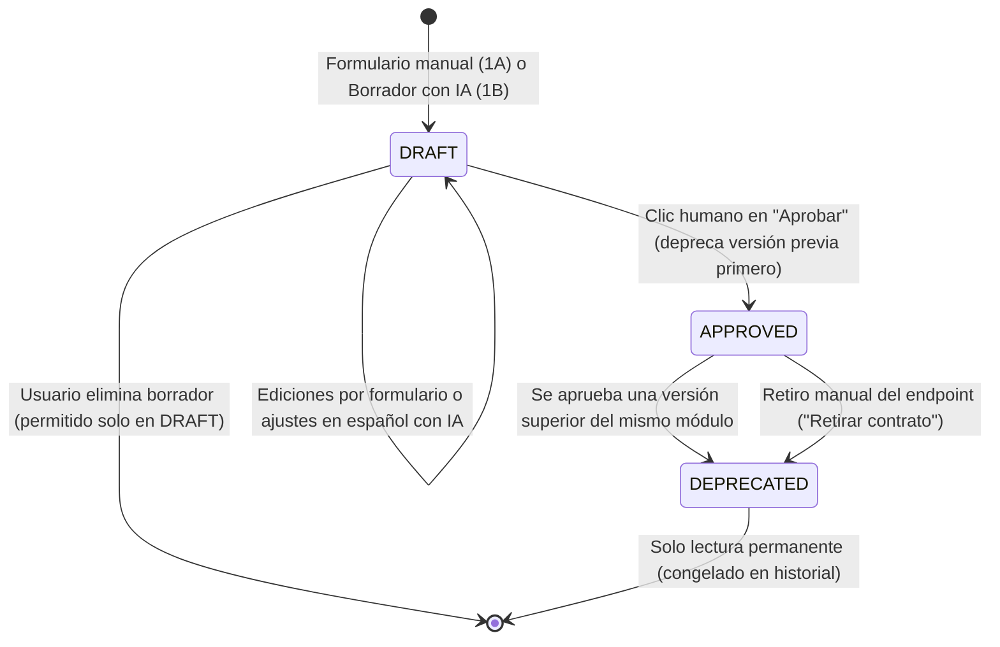
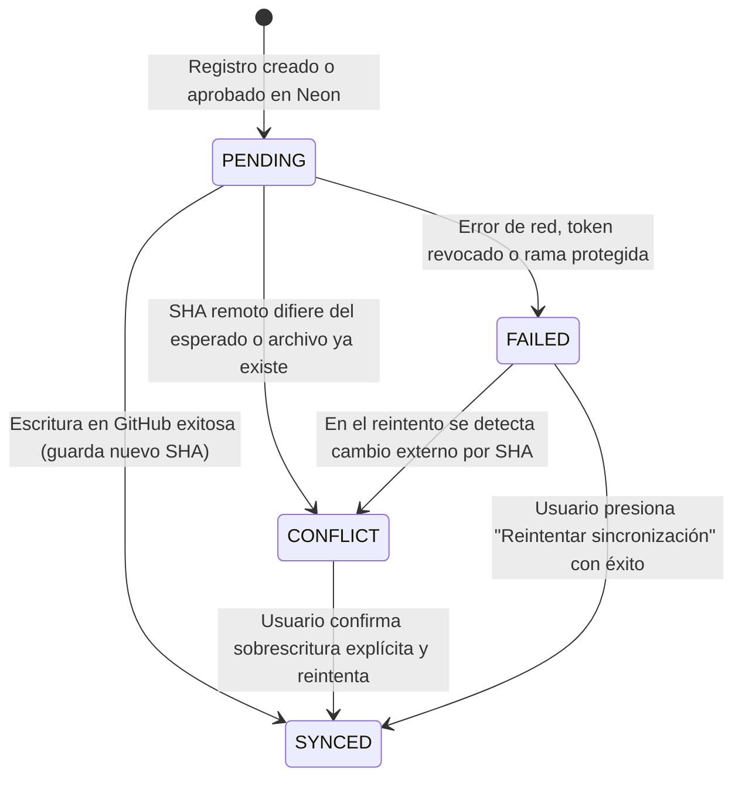
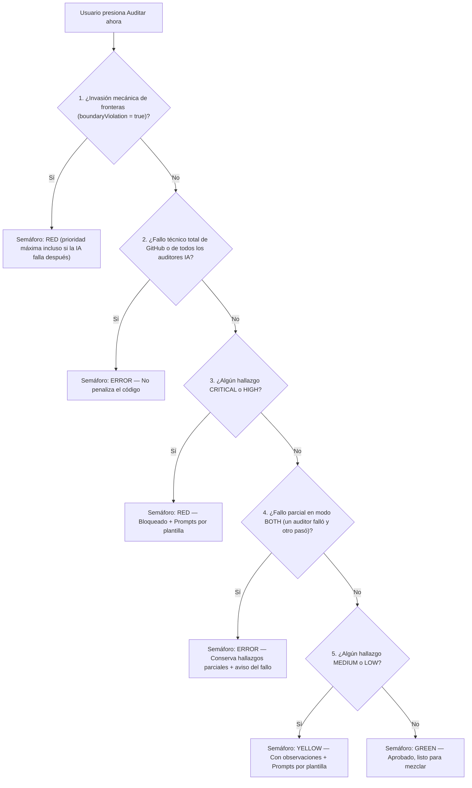

# 05.4 Diagramas de Ciclo de Vida y Estados

## 1. Propósito
Establecer todas las transiciones permitidas, excepciones documentadas, reglas de borrado y orden de evaluación para las entidades críticas del sistema: **Prompt Padre**, **Contratos**, **Sincronización con GitHub** y **Semáforo de Auditoría**.

---

## 2. Ciclo de Vida del Prompt Padre (`ParentPromptVersion.status`)

### Reglas y casos borde del Prompt Padre
* **Excepción documentada en el alta del proyecto:** Al conectar un repositorio nuevo (`POST /api/v1/projects`), la `v1` se inserta directamente en estado `ACTIVE` dentro de la misma transacción atómica que crea el `Project`.
* **Eliminación de borradores:** Un `DRAFT` sí puede eliminarse. El número de versión siguiente se calcula con `MAX(versionNumber) + 1`, por lo que eliminar un borrador puede dejar saltos numéricos sin afectar la integridad.
* **Inmutabilidad:** Los campos `content` y `summary` de una versión `ACTIVE` o `ARCHIVED` jamás se editan. Solo pueden cambiar `status`, `syncStatus`, `githubFileSha`, `syncedToGithubAt` y `lastSyncError`.
* **Ruta fija en GitHub:** La versión `ACTIVE` se sincroniza siempre en `.orquestador/prompt-padre.md`.

---

## 3. Ciclo de Vida de un Contrato (`Contract.status`)

### Reglas y casos borde de Contratos
* **Bloqueo contra auto-aprobación:** La IA solo crea o edita registros en `DRAFT`. Únicamente una acción autenticada del usuario humano puede cambiar `status` a `APPROVED` y registrar `approvedAt`.
* **Retiro sin sucesor:** Un contrato `APPROVED` puede pasar manualmente a `DEPRECATED` cuando un endpoint deja de existir en el proyecto (disparando actualización de `agents.md`).
* **Archivo compartido en GitHub:** Todas las versiones del mismo `moduleName` apuntan a `{contractsPath}/{moduleName}.contract.ts` en GitHub. GitHub conserva el archivo vigente (`APPROVED`) y su historial de commits; Neon conserva el snapshot exacto de `schemaJson` y `tsContent` de cada versión (`DEPRECATED` y `APPROVED`).
* **Cambio de `contractsPath`:** Si el usuario cambia `contractsPath` en la configuración del proyecto, los contratos `APPROVED` recalculan su ruta destino al resincronizarse, y `agents.md` pasa a `PENDING` avisando al usuario para sincronizar.

---

## 4. Ciclo de Vida de Sincronización con GitHub (`SyncStatus`)
Aplica independientemente a `Project.agentsMdSyncStatus`, `ParentPromptVersion.syncStatus` y `Contract.syncStatus`:

---

## 5. Lógica de Cálculo del Semáforo (`AuditRun.trafficLight`)
**Regla crítica de orden:** La validación mecánica de fronteras se ejecuta **siempre antes** de evaluar errores técnicos de IA, de modo que una invasión de carpeta nunca quede oculta bajo `ERROR`.

### Tabla de verdad del semáforo

| Condición detectada | Resultado `trafficLight` | ¿Genera `consolidatedFixPrompt`? |
| :--- | :--- | :--- |
| `boundaryViolation = true` (con o sin fallo posterior de IA) | `RED` | Sí (obligatorio, por plantilla fija) |
| Sin violación de frontera, pero fallo técnico total de API/red | `ERROR` | No (muestra aviso técnico y enlace a Configuración) |
| Sin violación de frontera, al menos 1 hallazgo `CRITICAL` o `HIGH` | `RED` | Sí (obligatorio, por plantilla fija) |
| Modo `BOTH`: un auditor respondió sin `CRITICAL`/`HIGH` y el otro falló | `ERROR` | Solo si hubo hallazgos `MEDIUM`/`LOW` en la capa exitosa + aviso de fallo parcial |
| Sin violación, sin fallos técnicos, sin `CRITICAL`/`HIGH`, con `MEDIUM`/`LOW` | `YELLOW` | Sí (por plantilla fija) |
| Sin violación, sin fallos técnicos y 0 hallazgos | `GREEN` | No (`null`) |
